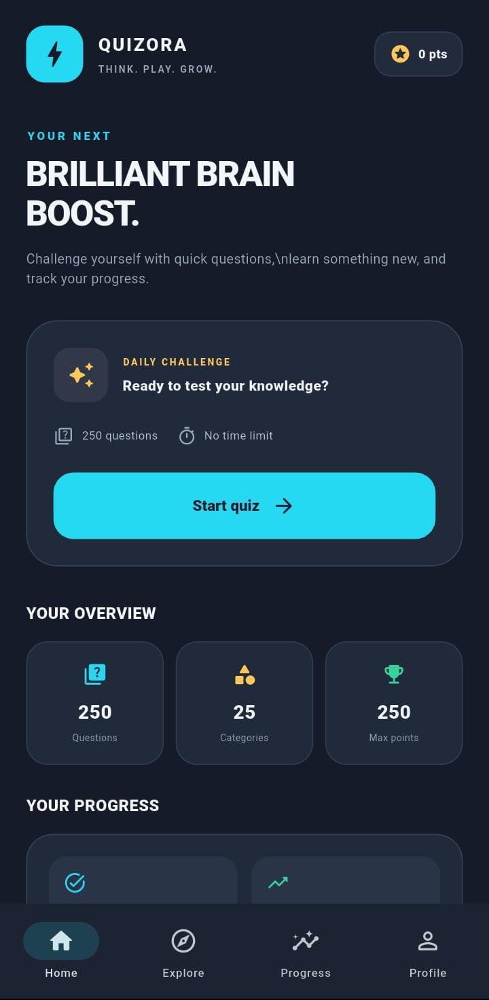
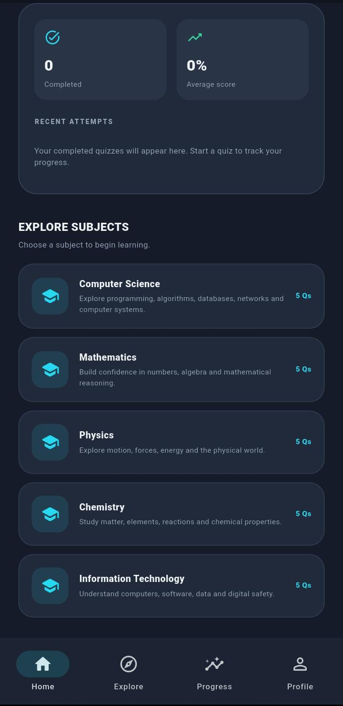

# 🎯 Quizora — Interactive Quiz App

<p align="center">
  <strong>Learn something new. Challenge yourself. Track your progress.</strong>
</p>

<p align="center">
  
  
  
  
  
</p>

## 📖 About

**Quizora** is an interactive quiz application developed using Flutter and Dart as part of the Auspify internship task series.

The application allows users to explore quiz topics, answer questions, review their results, and track their learning progress through a mobile-friendly interface.

## 📸 App Preview

<p align="center">
  
  &nbsp;&nbsp;
  
</p>

## ✨ Features

- 🧠 **Multiple Topics** — Explore 25 quiz topics across 5 subject areas.
- ❓ **Question Bank** — Practice with 250 quiz questions.
- 📝 **Interactive Quizzes** — Select answers and receive feedback.
- 📊 **Score Tracking** — View quiz results and performance.
- 📈 **Progress Tracking** — Keep track of quiz attempts.
- 🔐 **User Authentication** — Register, log in, and restore the saved session.
- 💾 **Local Data Storage** — Store user information and quiz attempts using SQLite.
- 🔄 **Replay Quizzes** — Restart quizzes and practice again.
- 📱 **Mobile-Friendly Interface** — Built with Flutter and Material Design.

## 🛠️ Tech Stack

| Technology | Purpose |
|---|---|
| Flutter | UI framework |
| Dart | Programming language |
| SQLite | Local database |
| Material Design | User interface |

## 🚀 Getting Started

### Prerequisites

Before running the application, make sure you have:

- Flutter SDK installed
- Dart SDK (included with Flutter)
- Android Studio or Visual Studio Code
- An Android emulator or physical Android device

### Installation

**1. Clone the repository**

```bash
git clone https://github.com/SilvaDeShakila/quizora-learning-app.git
```

**2. Navigate to the project directory**

```bash
cd quizora-learning-app
```

**3. Install dependencies**

```bash
flutter pub get
```

**4. Run the application**

```bash
flutter run
```

## 🧪 Testing

Run the automated Flutter tests:

```bash
flutter test
```

Analyze the project for code issues:

```bash
flutter analyze
```

## 📁 Project Structure

```text
task_04_quiz_app/
├── android/
├── assets/
├── lib/
│   └── main.dart
├── screenshots/
│   ├── quizora-preview-1.jpeg
│   └── quizora-preview-2.jpeg
├── test/
├── pubspec.yaml
└── README.md
```

*This is a simplified overview of the project structure.*

## 🎓 Project Information

- **Application:** Quizora
- **Project:** Interactive Quiz Application
- **Task:** Task 04 — Quiz App
- **Organization:** Auspify
- **Framework:** Flutter
- **Language:** Dart

## 👩‍💻 Developer

Developed as part of the Auspify internship task series.

---

<p align="center">
  <strong>Built with Flutter 💙</strong><br/>
  Keep learning. Keep challenging yourself.
</p>
